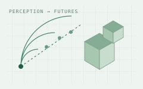
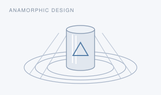
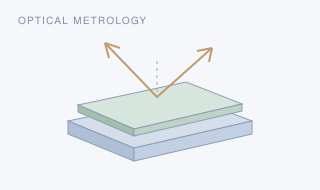

我是华一明，武汉大学微电子科学与工程专业本科生，研究兴趣是物理 AI、占据世界模型、多模态感知与 AI for Science。

I am a third-year undergraduate in <strong>Microelectronics Science and Engineering</strong> at <a href="https://www.whu.edu.cn/" target="_blank" rel="noopener noreferrer">Wuhan University</a>. I am interested in how intelligent systems perceive, model, and interact with the physical world.

My current work focuses on <strong>occupancy world models and camera–radar perception</strong>. I also explore AI for materials science and build agent-based tools for research, education, and creative applications.

<h1 id="research" data-i18n="researchTitle">💻 Research Experience</h1>

  
  

    
<strong data-i18n="university">Wuhan University</strong>

    
Research project · Physical AI

    
Camera–radar perception and occupancy world models, exploring how physical radar measurements can support future scene prediction. Work: HoRT.

  

  
  

    
<strong data-i18n="university">Wuhan University</strong>

    
Project lead · National Undergraduate Innovation Training Program (Key Project)

    
Studying attention-based representations of atomic structures for predicting defect properties in two-dimensional materials, with an emphasis on physical structure, evaluation, and materials screening.

    
<a href="https://github.com/chimeraHHH/2d-defect-dast" target="_blank" rel="noopener noreferrer" data-i18n="projectCode">Project code ↗</a>

  

<h1 id="publications" data-i18n="papersTitle">📝 Publications &amp; Manuscripts</h1>

  

  

    
HoRT: Horizon-wise Radar Transport for Camera–Radar 4D Occupancy Forecasting

    
Exploring how radar range and Doppler measurements can complement visual scene representations for future 3D occupancy prediction, with radar evidence aligned to different forecasting horizons.

  

  

  

    
Inverse ray tracing and semantic-constrained diffusion for cylindrical mirror anamorphic pattern design

    
<strong>Yiming Hua</strong>

    
<em>OIDL 2026</em> · Accepted

  

  

  

    
Robust Optical Metrology for Semiconductor Films via Adaptive Modeling and Two-Stage Optimization

    
<strong>Yiming Hua</strong>, Chengye Chai

    
<em>ICMMAP 2025</em> · Accepted

  

<h1 id="honors" data-i18n="honorsTitle">🎖 Honors &amp; Competitions</h1>
<ul>
  <li data-i18n="honorAdventure"><strong>Overall runner-up</strong>, AdventureX 2026 · Syncea.</li>
  <li data-i18n="honorMilan"><strong>National Second Prize</strong>, Milan Design Week China Collegiate Design Exhibition, 2026.</li>
  <li data-i18n="honorGeek"><strong>Most Promising to Continue Award</strong>, Tropic of Cancer Geek Festival, 2026.</li>
  <li data-i18n="honorDouyin"><strong>Third Prize, National Finals</strong>, Douyin AI Innovators Program, 2025 · VersoAI.</li>
  <li data-i18n="honorEth"><strong>Second Prize, Chain for Good track</strong>, ETHShanghai 2025 · ZK-Flex.</li>
  <li data-i18n="honorMath"><strong>Provincial First Prize</strong>, China Undergraduate Mathematical Contest in Modeling, 2025.</li>
  <li data-i18n="honorScholarship"><strong>Second Prize</strong>, Liu Daoyu Creative Learning Award, Wuhan University, 2025.</li>
</ul>

<h1 id="education" data-i18n="educationTitle">📖 Education</h1>

  
  

    
<strong data-i18n="university">Wuhan University</strong>2024 – Present

    
B.Eng. student in Microelectronics Science and Engineering School of Physics and Technology

  

<h1 id="projects" data-i18n="projectsTitle">🔬 Projects &amp; Open Source</h1>

<strong>Sophos 智象</strong> An agent-based educational animation engine that turns math and physics concepts into structured, animated explanations.

<strong><a href="https://github.com/chimeraHHH/verso-ai" target="_blank" rel="noopener noreferrer">VersoAI 织境 AI</a></strong> An AI storytelling workflow connecting script ideation, storyboard generation, and video creation.

<strong>Syncea 共潮生</strong> An interactive installation connecting jellyfish motion sensing, generative music, and wearable interaction.

<ul>
  <li><a href="https://github.com/chimeraHHH/materials_screening_agent_hermes" target="_blank" rel="noopener noreferrer"><strong>Materials Screening Agent</strong></a> — Evidence-oriented public-database retrieval and materials research workflows.</li>
  <li><a href="https://github.com/chimeraHHH/gpudeck-cli" target="_blank" rel="noopener noreferrer"><strong>GPUDeck CLI</strong></a> — A command-line interface for GPU reservations and machine-readable workflows.</li>
  <li><a href="https://github.com/chimeraHHH/OPEN-WHU" target="_blank" rel="noopener noreferrer"><strong>OPEN-WHU</strong></a> — An open collection of physics and electronics course resources at Wuhan University.</li>
</ul>

<footer class="site-credit">© 2026 Yiming Hua · Built with <a href="https://github.com/RayeRen/acad-homepage.github.io" target="_blank" rel="noopener noreferrer">AcadHomepage</a> (MIT License).</footer>
