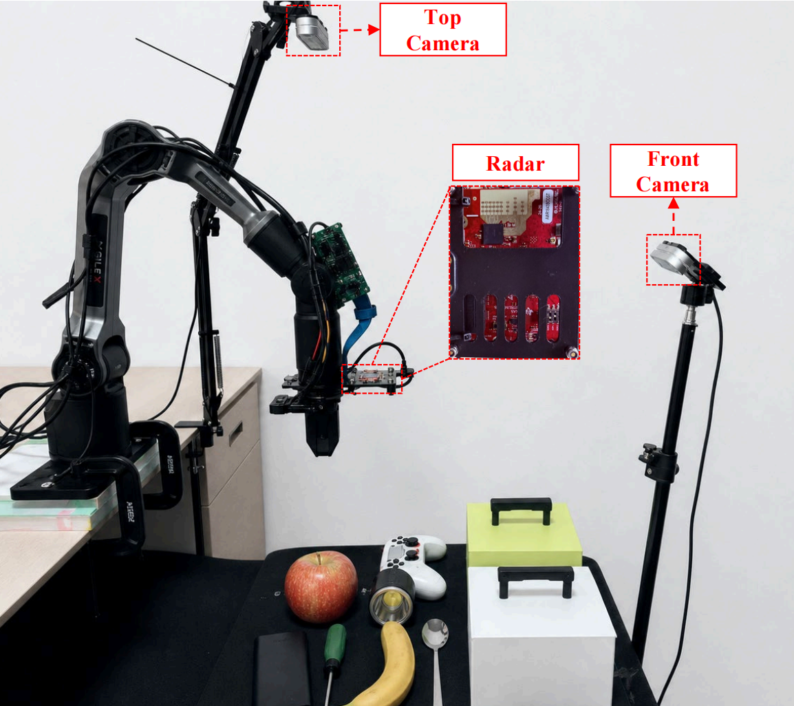
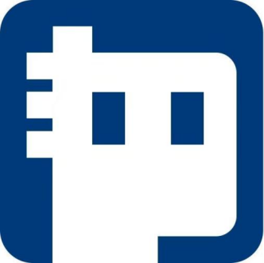

I am a third-year undergraduate in <strong>Microelectronics Science and Engineering</strong> at <a href="https://www.whu.edu.cn/" target="_blank" rel="noopener noreferrer">Wuhan University</a>. I am interested in how intelligent systems perceive, model, and interact with the physical world.

My current work focuses on <strong>occupancy world models and camera–radar perception</strong>. I also explore AI for materials science and build agent-based tools for research, education, and creative applications.

<h1 id="research">💻 Research Experience</h1>

  
  

    
<strong>Wuhan University</strong>

    
Research Intern · Mentor: Prof. Wei Wang

    
Camera–radar perception and occupancy world models, exploring how physical radar measurements can support future scene prediction. Work: HoRT.

  

  
  

    
<strong>Wuhan University</strong>

    
Project lead · Mentor: Prof. Sheng Chang

    
National Undergraduate Innovation Training Program (Key Project): Self-Attention-Based High-Throughput Prediction Platform for Defect Properties in Two-Dimensional Materials.

  

  
  

    
<strong>Fudan University</strong>

    
Research Intern · Mentor: Prof. Yuanbo Zhang

    
Material Screening Agent: evidence-oriented public-database retrieval and materials research workflows.

    
<a href="https://github.com/chimeraHHH/materials_screening_agent_hermes" target="_blank" rel="noopener noreferrer">Project code ↗</a>

  

<h1 id="publications">📝 Publications &amp; Manuscripts</h1>

  

  

    
HoRT: Horizon-wise Radar Transport for Camera–Radar 4D Occupancy Forecasting

    
<strong>Yiming Hua</strong>, Ning Wang, Wei Wang

    
<em>CVPR 2027</em> · Under Review · <strong>First Author</strong>

    
Exploring how radar range and Doppler measurements can complement visual scene representations for future 3D occupancy prediction, with radar evidence aligned to different forecasting horizons.

    
<a href="/images/hort-main.png" target="_blank" rel="noopener noreferrer">Full Figure ↗</a>

  

  

  

    
RadarSim2Act: Closing the Radar Sim-to-Real Loop for Robotic Manipulation

    
Ning Wang, Ruijie Zhang, <strong>Yiming Hua</strong>, Qian Zhang, Wei Wang

    
RadarSim2Act learns a radar-conditioned vision–language–action policy entirely in simulation from synthetic mmWave observations, then adapts to a real robot using a small set of vision-only demonstrations. Without real radar–action training data, it achieves 90% success across 10 manipulation tasks involving visually occluded targets on a 77 GHz radar-equipped robot and generalizes to unseen object categories.

    
<a href="/images/radarsim2act-robot-setup.png" target="_blank" rel="noopener noreferrer">Full Figure ↗</a>

  

<h1 id="honors">🎖 Honors &amp; Competitions</h1>
<ul>
  <li><strong>Luojia Talent Innovation Scholarship</strong>, Wuhan University, 2026 (one of only three undergraduate recipients university-wide).</li>
  <li><strong>Overall runner-up</strong>, AdventureX 2026 · Syncea.</li>
  <li><strong>National Second Prize</strong>, Milan Design Week China Collegiate Design Exhibition, 2026.</li>
  <li><strong>Most Promising to Continue Award</strong>, Tropic of Cancer Geek Festival, 2026.</li>
  <li><strong>Third Prize, National Finals</strong>, Douyin AI Innovators Program, 2025 · VersoAI.</li>
  <li><strong>Second Prize, Chain for Good track</strong>, ETHShanghai 2025 · ZK-Flex.</li>
  <li><strong>Provincial First Prize</strong>, China Undergraduate Mathematical Contest in Modeling, 2025.</li>
  <li><strong>Second Prize</strong>, Liu Daoyu Creative Learning Award, Wuhan University, 2025.</li>
</ul>

<h1 id="education">📖 Education &amp; Title</h1>

  
  

    
<strong>Wuhan University</strong>2024 – Present

    
B.Eng. student in Microelectronics Science and Engineering School of Physics and Technology

  

  
  

    
<strong>University of Cambridge</strong>Jan 2026

    
Artificial Intelligence Technology Exchange

  

  
  

    
<strong><a href="https://www.dxh.gov.cn/XWZX/LKGYW/202610/t20261009_2858156.shtml" target="_blank" rel="noopener noreferrer">Wuhan Hackathon</a></strong>2026 – Present

    
Founder

  

  
  

    
<strong>Wuhan University Blockchain Association</strong>2025 – Present

    
President

  

<h1 id="projects">🔬 Projects &amp; Open Source</h1>

<strong>Self-Attention-Based High-Throughput Prediction Platform for Defect Properties in Two-Dimensional Materials</strong> Approved as a National-Level Key Project under the Undergraduate Innovation and Entrepreneurship Training Program (top 1% university-wide).

<strong>Sophos</strong> An agent-based educational animation engine that turns math and physics concepts into structured, animated explanations.

<strong><a href="https://github.com/chimeraHHH/verso-ai" target="_blank" rel="noopener noreferrer">VersoAI</a></strong> An AI storytelling workflow connecting script ideation, storyboard generation, and video creation.

<strong><a href="https://gallery.adventure-x.cn/projects/cmrzsxh9g001s02jirutu91me" target="_blank" rel="noopener noreferrer">Syncea</a></strong> An interactive installation connecting jellyfish motion sensing, generative music, and wearable interaction.

<a href="https://github.com/chimeraHHH/materials_screening_agent_hermes" target="_blank" rel="noopener noreferrer"><strong>Material Screening Agent</strong></a> — Evidence-oriented public-database retrieval and materials research workflows.

<a href="https://github.com/SuperJJ007/CSSwitch" target="_blank" rel="noopener noreferrer"><strong>CSSwitch</strong></a> (<strong>490+ stars</strong>) — Connects Claude Science to user-provided API endpoints.

<footer class="site-credit">© 2026 Yiming Hua · Built with <a href="https://github.com/RayeRen/acad-homepage.github.io" target="_blank" rel="noopener noreferrer">AcadHomepage</a> (MIT License).</footer>
